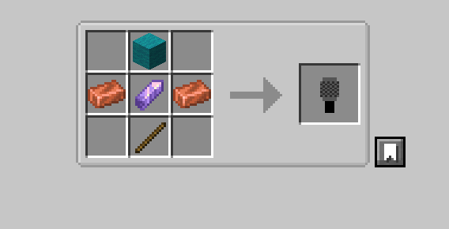

# Plotcards

A Fabric mod for Minecraft 26.3 themed around the band **The Plot in You**.
Trading cards drop from mobs you kill, and holding or collecting them unlocks
real in-game perks — buffs, playable music, and a very aggressive prop mic.

## Installing

1. Install [Fabric Loader](https://fabricmc.net/use/) 0.20.1+ for Minecraft
   26.3, with Java 25.
2. Grab the matching **Fabric API** jar and drop it in your `mods/` folder.
3. Grab `tpi_trading_cards-<version>.jar` from this repo's
   [Releases](../../releases) (or `build/libs/` if you built it yourself) and
   drop it in `mods/` too.

Everyone in the world/server needs the same mod —
it isn't client-only.

## The 17 cards

| Category | Cards |
|---|---|
| Songs (12) | Divide, Left Behind, Forgotten, Closure, Don't Look Away, Been Here Before, Pretend, All That I Can Give, Spare Me, Silence, You Get One, Carved |
| Band members (4) | Landon Tewers, Josh Childress, Ethan Yoder, Michael Cooper |
| Mascot (1) | Sox |

Each card has a rarity, shown as a colored line in its tooltip:

| Rarity | Color | Cards |
|---|---|---|
| Common | Gray | Forgotten, Been Here Before, All That I Can Give |
| Uncommon | Green | Left Behind, Closure, You Get One |
| Rare | Aqua | Don't Look Away, Pretend, Silence |
| Legendary | Gold | Divide, Spare Me, Carved, Josh Childress, Ethan Yoder, Michael Cooper |
| Mythic | Light purple | Landon Tewers, Sox |

## Getting cards

Cards drop from hostile mobs you kill — never bought or crafted from scratch.
Every card has its own independent chance to drop on every kill, so
(rarely) a single kill can drop more than one card. Roughly:

- **Common** cards: about 1-in-20 kills drops *some* common card.
- **Uncommon**: about 1-in-40 kills.
- **Rare**: about 1-in-50 kills — but see below, this is mostly meant to come
  from bonus mobs, not regular grinding.
- **Legendary**: about 1-in-75 kills, same caveat.

Three specific mobs roll a much bigger **bonus chance** for a random
Rare-or-Legendary card, on top of their normal tiny chance — this is the
intended way to actually get rares/legendaries without every zombie needing
to be a jackpot:

| Mob | Bonus chance |
|---|---|
| Enderman | 1.5% |
| Warden | 10% |
| Wither | 50% |

**Mythic** cards (Landon and Sox) share one separate, very rare roll
(0.001% per kill) — a hit picks one of the two at random. Killing the
**Ender Dragon always drops one mythic card**, guaranteed, regardless of
everything else.

**Looting helps.** Looting on the killing blow boosts every roll above
(including mythic) by 50% per level — a Looting III weapon gives 2.5x the
normal chance for everything.

Server owners can retune every chance above without a rebuild by editing
`config/tpi_trading_cards.json` (created after first launch) and restarting.
There's also a `requirePlayerKill` toggle (on by default) so mobs dying to
fire/fall/etc. don't drop cards.

## Holding a card

Cards aren't just tooltips — how you hold one changes what it does:

- **Main hand**: the card renders big and two-handed, facing the camera,
  the same way a filled map does.
- **In an item frame**: hover your crosshair over a framed card to see its
  song/artist name float up as a hologram, just like a custom-named item.
- **Off-hand**: the card grants a passive buff as long as it stays there
  (see below) — this is the only slot that grants buffs.

## Off-hand buffs

Hold a card in your off-hand and it quietly applies effects every half
second, no activation needed:

| Card | Effect(s) |
|---|---|
| Common song | Speed I |
| Uncommon song | Haste I |
| Rare song | Strength I |
| Legendary song | Speed II + Resistance I |
| Any band member | Night Vision + Health Boost I (2 hearts) |
| Landon Tewers | All of the above, **plus** Hero of the Village I |
| Sox | Dolphin's Grace I + Jump Boost I + Speed II + Absorption II (4 hearts) |

Band member cards get one more trick: they also grant whatever song effect
matches the **highest-rarity song card you own anywhere in your inventory**
(not necessarily held) — so pairing, say, Landon in your off-hand with a
Legendary song card sitting in your inventory stacks that song's buff on
top automatically. It doesn't stack twice from multiple song cards — just
the single best one counts.

## Music discs

The mod has a music disc for **74 songs** — the band's discography from the
*Wife Beater* EP (2009) through the self-titled album (2026). Discs play in
any jukebox like vanilla ones, no Audioplayer or voice chat mod needed. The
tooltip shows the song plus the release it's from, the label color shows the
release, and comparators read the track number (1–15).

**Pressing a record:** collect **nine copies of the same song card** and
combine them at a crafting table to press that song's disc. Only the 12
self-titled-album songs have cards, so only those 12 discs are craftable for
now; the rest are in the creative tab (or `/give`).

**Audio isn't in this repo.** The songs are copyrighted, so the `.ogg` files
are git-ignored and only go into privately built jars. Without them the discs
still exist and spin in a jukebox, just silently. Audio goes in
`src/main/resources/assets/tpi_trading_cards/sounds/records/<song_id>.ogg`
(mono Ogg Vorbis), with each song's length in
`src/main/resources/data/tpi_trading_cards/jukebox_song/<song_id>.json`.

## The band (NPCs)

**Landon Tewers, Josh Childress, Ethan Yoder and Mikey Cooper** wander the
overworld as friendly NPCs. They use the real player model with their own
skins, and their names float above their heads like a player's.

- **Daytime only:** they spawn naturally during the day, on grass under open
  sky, in any overworld biome. They're rare: each member has the spawn weight
  of a donkey by default.
- **Friendly:** they stroll around, look at nearby players and run from hostile
  mobs. Hit one and it panics like a villager; they never fight back.
- **Wanderers:** like a wandering trader, they leave (despawn) once nobody's
  nearby, so random spawns don't pile up. Use a **name tag** on one to keep it.
- **Spawn eggs** for all four are in the creative tab.

Tune or disable natural spawning with `bandMemberSpawnWeight` in
`config/tpi_trading_cards.json` (0 = eggs only; needs a restart).

## Captain Sox

A black-and-white tuxedo cat in a captain's pirate hat (black half-moon with
gold trim, skull and crossbones, red band and ribbon, ears poking out in front),
the mascot from the Sox card.
He's a real Minecraft cat underneath, so everything cats do, he does.

- **Spawning:** occasionally on grass anywhere in the overworld, day or night
  (about as rare as a donkey). An untamed Captain Sox wanders off when nobody's
  around, like any stray cat. There's also a spawn egg in the creative tab.
- **Taming:** feed him **raw or cooked cod, salmon or chicken** (each bite has
  the usual 1-in-3 cat chance). Once tamed he sits, follows, sleeps on your
  bed, scares off creepers and phantoms, and heals from the same foods.
- **One of a kind:** he doesn't breed.
- **Card drop:** small chance (5% by default) to drop the **Sox** trading card
  when he dies.

Tune with `captainSoxSpawnWeight` (0 = egg only) and `captainSoxCardDropChance`
in `config/tpi_trading_cards.json`.

## Concert stages

Concert stages generate naturally in the overworld, on flat land
(plains, sunflower plains, meadows, savannas, snowy plains and deserts),
roughly one per 40×40-chunk area. Each one is a full stage with a roof,
red curtains, lights, note blocks, a microphone at the front of the crowd
area, and a framed *Wife Beater* disc.

- Find the nearest one: `/locate structure tpi_trading_cards:concert_stage`
- Place one where you're standing: `/place structure tpi_trading_cards:concert_stage`
- Stages only appear in **newly generated chunks**. Explore new terrain, or
  start a new world.

The build lives at `src/main/resources/data/tpi_trading_cards/structure/concert_stage.nbt`
(a normal structure-block file, so you can also load it with a structure
block). Spacing, biomes and rarity are plain JSON under
`data/tpi_trading_cards/worldgen/` and `tags/worldgen/biome/has_structure/`.

## The microphone

A craftable prop for the true frontman experience:



Any wool color works on top — copper ingot on each side, amethyst shard in
the middle, stick on the bottom.

- **Place it** on a floor, wall, or ceiling and it orients itself to match
  the surface, just like an End Rod.
- **Right-click** while holding it (not aimed at a surface) to "sing" into
  it — plays the eating-style animation for a few seconds, no item consumed.
- **Hit an entity with it** and they go flying — 5 damage plus a huge
  knockback impulse, roughly 10 blocks on open ground (less over rough
  terrain or against knockback-resistant mobs, same physics as any other
  knockback).
- **Enchantable** at an enchanting table or anvil just like a sword —
  Sharpness, Knockback, Looting, Fire Aspect, Sweeping Edge, Unbreaking,
  Mending, and Curse of Vanishing all apply.
- **Can't break blocks** — same restriction real swords have, so swinging
  it at something (or clicking in creative) never destroys terrain.

## Achievements

- **The Plot in You** — craft a crafting table (the root achievement).
- One achievement per self-titled song, awarded the first time you press that
  song's disc (12 total).
- **The Full Discography** — press all 12 self-titled songs.
- **Crowd Control** — craft a microphone for the first time.

## Tuning / config reference

`config/tpi_trading_cards.json`:

```json
{
  "commonCardDropChance": 0.0166667,
  "uncommonCardDropChance": 0.0083333,
  "rareCardDropChance": 0.0066667,
  "legendaryCardDropChance": 0.0022222,
  "mythicCardDropChance": 0.00001,
  "endermanRareOrLegendaryBonusChance": 0.015,
  "wardenRareOrLegendaryBonusChance": 0.10,
  "witherRareOrLegendaryBonusChance": 0.50,
  "requirePlayerKill": true,
  "lootingBonusPerLevel": 0.5
}
```

Each chance is a fraction of 1.0, applied per hostile mob kill,
independently per card. Restart the server (or reload the world) after
editing.

## Building from source

Requires JDK 25. `./gradlew build` from the repo root; the jar lands in
`build/libs/`.
